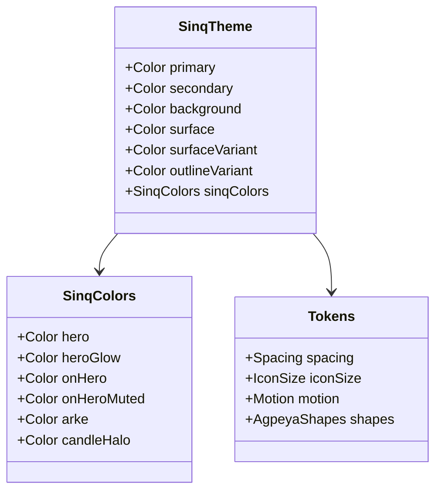

# Sinq (ስንቅ) — Complete Technical, Design & Feature Architecture

> **"ስንቅ — Provisions for the spiritual journey."**  
> Sinq is an authentic, distraction-free Android application dedicated to the complete liturgical corpus, scriptural canon, and daily devotional prayer life of the **Ethiopian Orthodox Tewahedo Church (EOTC)**.

---

## 1. Executive Mission, Theology & Identity

### 1.1 The Meaning of "Sinq"
In Ge'ez and Amharic, *Sinq* (ስንቅ) signifies the provisions, rations, and spiritual nourishment prepared by a traveler embarking on an arduous pilgrimage. Sinq is built for the Christian soul navigating daily life in the modern world—providing immediate, offline access to the canonical prayer hours, the ancient lectionary, the complete scriptural canon, and the lives of the saints.

### 1.2 Core Architectural Principles
1. **100% Offline & Sovereign**: The entire liturgical library—Bible, Psalter, Horologium, Synaxarium, Mahlet, and Lectionary—ships bundled inside the application assets (`app/src/main/assets/content/`). No network connection is ever required for prayer or scripture reading.
2. **Zero-Telemetry Privacy**: No user accounts, no analytics SDKs, no tracking pixels, and no cloud synchronization. Spiritual journal reflections, confession drafts, and prayer habits remain encrypted strictly on the user's physical hardware.
3. **Non-Punitive Devotional Model**: Secular apps employ gamified "streaks", aggressive push notifications, and guilt-inducing "broken streak" banners designed to trigger dopamine and anxiety. Sinq rejects this paradigm: prayer is an encounter of grace and repentance, not a streak to be maintained. The app welcomes the user back gently whether they prayed yesterday or missed six months.
4. **Sacred Aesthetics (Calm Over Clutter)**: The interface draws visual inspiration directly from traditional Ethiopian illuminated parchment manuscripts (የብራና መጻሕፍት). Visual hierarchy is created through negative space, harmonic typography, and subtle manuscript rules rather than nested cards and commercial UI tropes.
5. **Contract Permanence**: Section identifiers and verse keys are immutable content-addressed contracts (`scripture:<edition>:<book>:<chapter>:<verse>`). User highlights, bookmarks, and journal cross-references never break across app updates.

---

## 2. Complete Liturgical & Scriptural Corpus Architecture

```mermaid
graph TD
    Root["Sinq Liturgical Engine"] --> Horologium["The Horologium (መጽሐፈ ሰዓታት)"]
    Root --> Scripture["Canonical Scripture & Psalter"]
    Root --> Computus["Computus (ባሕረ ሐሳብ) & Lectionary (ግጻዌ)"]
    Root --> Synaxarium["The Synaxarium (መጽሐፈ ስንክሳር)"]
    Root --> Hymnody["Hymnody & Bookshelf"]
    Root --> Patristics["Patristic Commentary (Catena Integration)"]

    Horologium --> H1["7 Canonical Hours"]
    Horologium --> H2["3 Midnight Watches (ትጋት)"]
    Horologium --> H3["Veil Prayer (ሌሊት ፱ ሰዓት)"]

    Scripture --> S1["81-Book Bible (Amharic 1980 / NKJV Parallel)"]
    Scripture --> S2["150 LXX Psalms (መዝሙረ ዳዊት)"]
    Scripture --> S3["15 Canticles of the Prophets (ጸሎተ ነቢያት)"]
    Scripture --> S4["Ge'ez 1980 Parallel Psalter"]

    Computus --> C1["Bahre Hasab Algorithmic Engine"]
    Computus --> C2["366-Day Gitsawe Lectionary"]
    Computus --> C3["Fasting Calendar (አጽዋማት)"]
    Computus --> C4["Sunday Cycle & Mezmur Appointments"]

    Synaxarium --> Syn1["Parallel Amharic & Ge'ez 366 Days"]
    Syn1 --> Syn2["1,017 Verified Arke Hymns (አርኬ)"]
    Syn1 --> Syn3["Liturgical Closing Benedictions"]

    Hymnody --> Hy1["ሥርዓተ ማኅሌት (181 Feast Orders)"]
    Hymnody --> Hy2["ውዳሴ ማርያም (Monday–Sunday)"]
    Hymnody --> Hy3["ውዳሴ አምላክ (8 Daily Sections)"]
    Hymnody --> Hy4["32 Canonical Melkea (መልክአ መልክዕ)"]
    Hymnody --> Hy5["37 Curated Church Books"]

    Patristics --> P1["Automatic LXX-to-Masoretic Offset Mapping"]
    Patristics --> P2["Patristic Reflections (Chrysostom, Athanasius, Cyril)"]
```



### 2.1 The Seven Canonical Hours (መጽሐፈ ሰዓታት)
Sinq implements the full canonical cycle of the Ethiopian Horologium:
- **ነግህ (Morning / Prime - 6:00 AM / 12:00 ጧት)**: The morning prayer commemorating the Resurrection of Jesus Christ, the creation of the world, and thanksgiving for the dawn.
- **ሠለስት (Terce / 3rd Hour - 9:00 AM / 3:00 ረፋድ)**: Commemorating the condemnation of Christ before Pontius Pilate and the descent of the Holy Spirit upon the Apostles on Pentecost.
- **ቀትር (Sext / 6th Hour - 12:00 PM / 6:00 ቀን)**: Commemorating the Crucifixion of Christ at Golgotha and the midday darkness.
- **ተሰዓት (None / 9th Hour - 3:00 PM / 9:00 ከሰዓት)**: Commemorating the death of Christ upon the Cross and the opening of Paradise to the penitent thief.
- **ሰርክ (Vespers / 11th Hour - 6:00 PM / 12:00 ምሽት)**: The sunset prayer of thanksgiving, commemorating the taking down of Christ's body from the Cross.
- **ንዋም (Compline / 12th Hour - 9:00 PM / 3:00 ማታ)**: The bedtime prayer commemorating the burial of Christ, requesting peaceful rest and repentance before sleep.
- **መንፈቀ ሌሊት (Midnight)**: Divided into three distinct watches (*Tigat* / ትጋት):
  - *፩ኛ ትጋት*: First watch commemorating the Lord's agony and prayer in Gethsemane.
  - *፪ኛ ትጋት*: Second watch commemorating the betrayal, arrest, and trial of the Savior.
  - *፫ኛ ትጋት*: Third watch anticipating the Second Coming of Christ and the cockcrow.
- **ጸሎተ መንፈቀ ሌሊት (Veil / Night 9th Hour)**: Monastic supplication said in stillness before dawn.

### 2.2 Canonical Scripture, Septuagint Psalter & Canticles
- **81-Book Canon**: Houses the full Ethiopian Orthodox canon comprising the Protocanonical books, Deuterocanonical books, and books unique to the Ethiopian canon (1 Enoch / መጽሐፈ ሄኖክ, Jubilees / መጽሐፈ ኩፋሌ, 1–3 Meqabyan / መቃብያን, Josippon / ዜና አይሁድ, etc.).
- **Parallel Translation Engine**: Users can read the Amharic 1980 biblical text alongside the English New King James Version (NKJV) or switch editions at the chapter level.
- **LXX Psalter (መዝሙረ ዳዊት)**: All 150 Psalms follow canonical Septuagint numbering (as preserved in the Ethiopian tradition) with instant Amharic and Ge'ez 1980 parallel switching.
- **Biblical Canticles (ጸሎተ ነቢያት)**: 15 ancient biblical prayers, including the Prayer of Moses (ጸሎተ ሙሴ), Song of Hannah (ጸሎተ ሐና), Prayer of Jonah (ጸሎተ ዮናስ), Magnificat (ጸሎተ ማርያም), and the Song of Simeon (ጸሎተ ስምዖን).

### 2.3 Patristic Commentary Integration (Catena Bible)
Sinq bridges offline biblical reading with early Church patristic reflections via an integration with Catena Bible:
- **LXX to Masoretic Citation Offset Resolver (`CatenaLink.kt`)**: The Ethiopian Orthodox Psalter numbers Psalms according to the Septuagint (LXX), whereas Western commentary systems follow Masoretic numbering. Sinq algorithmically converts citations (e.g. LXX Psalm 22 "The Lord is my shepherd" automatically resolves to Masoretic Psalm 23 on Catena), ensuring the reader always arrives at the authentic commentary for the passage they are reading.
- **Strict Privacy Boundary**: Reading stays 100% offline; network interaction occurs only if the user explicitly triggers the external commentary link.

### 2.4 The Computus Engine (ባሕረ ሐሳብ)
The mathematical computus is calculated completely on-device (`BahreHasab.kt`) using traditional Ethiopian calendar astronomy:
- **Core Computus Variables**:
  - `ameteAlem` (ዓመተ ዓለም): Total years from Creation (5500 BC + current EC year).
  - `wenber` (ወንበር): The 19-year Metonic lunar cycle remainder.
  - `abekte` (አበቅቴ): The epact (accumulated lunar deficit).
  - `metqi` (መጥቅዕ): The paschal lunar threshold.
  - `tinteQemer` (ጥንተ ቀመር): Solar and weekday alignments.
- **Automated Calculation of Movable Feasts & Fasts**:
  - Nineveh Fast (ጾመ ነነዌ)
  - Great Lent (ዓቢይ ጾም) and Holy Week (ሕማማት)
  - Palm Sunday (ሆሣዕና) & Good Friday (ስቅለት)
  - Resurrection / Easter (ፋሲካ)
  - Synod of Priests (ርክበ ካህናት)
  - Ascension (ዕርገት)
  - Pentecost (ጰራቅሊጦስ)
  - Fast of the Apostles (ጾመ ሐዋርያት)
  - Fast of Salvation (ጾመ ድህነት - Wednesday/Friday fast)

### 2.5 The 366-Day Lectionary (መጽሐፈ ግጻዌ)
- **Comprehensive Daily Appointments**: Complete scripture readings appointed for every single day of the year, categorized into:
  - Fixed calendar days (366 dates across the 13 Ethiopian months).
  - Movable seasonal offices (Great Lent, Paschal season, Apostles' Fast).
  - Sunday liturgical cycle (*Sirkate Senbet* / ሥርዐተ ሰንበት) with appointed Sunday *Mezmur* (መዝሙር).
- **Four Canonical Lections**: Every office appoints Pauline Epistle, Catholic/General Epistle, Acts of the Apostles, and the Holy Gospel, preceded by the appointed Psalm verse (ምስባክ) in Ge'ez with traditional musical notation markers.
- **Instant Codex Navigation**: Tapping any citation in the Gitsawe opens that passage in the unified Scripture reader.

### 2.6 The Synaxarium (መጽሐፈ ስንክሳር)
- **Parallel Amharic and Ge'ez Editions**: Covers all 366 days of the Ethiopian year.
- **1,017 Verified Arke Hymns (አርኬ)**: Traditional poetic concluding strophes dedicated to the commemorated saints, highlighted in liturgical ruby red.
- **Daily Commemorations & Patristic Profiles**: Exhaustive biographies and miracles of the ancient prophets, martyrs, desert fathers, and Ethiopian saints (St. Tekle Haymanot, St. Gebre Menfes Kidus, St. Yared, Abba Samuel of Waldebba, etc.).

### 2.7 Hymnody & The Expanded Liturgical Library
- **ሥርዓተ ማኅሌት (Order of Chants - 181 Feast Orders)**: Curated feast orders for major Church celebrations, organized into Vigil (*Wazema* / ዋዜማ), Dawn Hymns (*Negs* / ነግሥ), and Processional Chants (*Angergari* / አንገርጋሪ), with special seasonal devotion for the Season of Flowers (*Zemene Tsige* / ዘመነ ጽጌ).
- **ውዳሴ ማርያም (Praises of Mary)**: Appointed for each day of the week (Monday through Sunday), accompanied by *Yewedsewa Melaekt* (ይወድስዋ መላእክት) and *Anqetse Berhan* (አንቀጸ ብርሃን), with seamless Amharic/Ge'ez text toggles.
- **ውዳሴ አምላክ (Praises of God)**: Complete 8 canonical daily sections attributed to St. Cyril of Alexandria, St. Ephrem the Syrian, and the Desert Fathers.
- **32 Canonical Melkea (መልክአ መልክዕ)**: Sacred poetic hymns honoring the physical and spiritual aspects of Christ, the Virgin Mary, and the angels.
- **37 Curated Church Books**: Foundational patristic texts, including the Book of the Mystery (*Metsihafe Mestir* / መጽሐፈ ምሥጢር by Abba Giyorgis of Gasicha), Faith of the Fathers (*Haymanote Abew* / ሃይማኖተ አበው), and the Book of Monks (*Mar Isaac*, *Filkesyus*, *Aragawi Menfesawi*).

---

## 3. Design System & Visual Language

The design system is codified in `app/src/main/java/com/agpeya/app/ui/theme/` and detailed in `docs/DESIGN_SYSTEM.md`.



### 3.1 The Liturgical Palette & Sacred Color Roles

| Token | Light Scheme (Sacred Ivory) | Dark Scheme (Liturgical Night) | Semantic Purpose |
|---|---|---|---|
| **`background`** | `#FAF7EF` (Goatskin Vellum) | `#0B2822` (Deep Forest Monastery) | Primary reading ground; non-glare, warm illumination |
| **`surface`** | `#FFFFFF` | `#0E3B31` (Rich Liturgical Green) | Card and container elevation ground |
| **`secondary`** | `#7E5F1E` (Bronzed Gold) | `#E0BC65` (Radiant Fillet Gold) | Sacred accents, Ge'ez numerals, active habit rings, kickers |
| **`primary`** | `#1C5E4E` (Emerald Accent) | `#8AD6BE` (Soft Sage) | Material controls, toggles, sliders, active tab indicators |
| **`outlineVariant`** | `#E5DEC9` (Parchment Hairline) | `#235448` (Muted Pine Hairline) | Hairline borders, manuscript frames, subtle dividers |
| **`sinqColors.hero`** | `#0E3B31` (Constant Brand Green) | `#0E3B31` (Constant Brand Green) | Sacred NowCard hero background (identical across themes) |
| **`sinqColors.heroGlow`** | `#F5D580` (Gold Aura) | `#E8C46B` (Gold Aura) | Clipped radial golden dawn bloom |
| **`sinqColors.arke`** | `#B3261E` (Crimson Red) | `#FF8A80` (Luminous Coral) | Traditional Ethiopian manuscript rubrication (ቀይ ጽሑፍ) |

### 3.2 Ethiopic Typographic Engine

Ethiopic script (ግዕዝ ፈደላት) has unique orthographic and perceptual requirements that break standard Western type layout rules:

1. **Zero Letter-Spacing**: Western engines track small labels outward by 0.25sp to 0.5sp. In Ethiopic, every glyph is a syllabary representing a consonant-vowel union. Letter-spacing creates visible gaps that disintegrate syllables. Sinq enforces strict zero letter-spacing (`letterSpacing = 0.sp`) across all typography roles.
2. **Center-Box Leading Without Font Padding**: Android's default `includeFontPadding = true` adds unpredictable vertical padding to accommodate tall Latin ascenders/descenders. On Ethiopic fonts (which have tall uppercase-like glyphs), this introduces invisible leading that pushes text off-center against icons. Sinq disables font padding globally and centers the line box.
3. **Per-Face Optical Scale Harmonization**: Sinq bundles six specialized Ethiopic typefaces. Because their intrinsic x-heights differ significantly, an uncompensated 18sp text will look huge in *Bela Bereka* and tiny in *Abay Light*. Sinq applies an optical scaling factor (`opticalScale`) to ensure perceptually uniform font sizing:

| Bundled Font Family | Optical Multiplier | Character & Aesthetic Tradition |
|---|---|---|
| **Abyssinica SIL** | `1.00x` | Canonical digital reference; crisp, formal liturgical print |
| **Abay Light** | `1.04x` | Slender, elegant, high-legibility contemporary face |
| **Bela Bereka** | `0.94x` | Robust traditional monastic chirography with bold strokes |
| **Zemenay** | `0.98x` | Classic ecclesiastical scribe style with rounded counters |
| **Abba Garima** | `0.96x` | Archaic 5th-century gospel manuscript calligraphic profile |
| **Waldba** | `1.02x` | Specialist ascetic monastic manuscript typeface |

4. **Reader Size Steps**: Six discrete reader sizes: **16sp, 18sp (Default), 20sp, 22sp, 25sp, and 28sp**, with line spacing options of **Compact (1.25x), Normal (1.45x), and Relaxed (1.70x)**.
5. **Reading Max-Width Constraint**: Lines of text on tablets or foldables are capped at `ReadingMaxWidth = 640.dp`. This preserves optimal characters-per-line (CPL) readability, preventing reading surfaces from stretching into unreadable wide sheets.

### 3.3 The Sacred Manuscript Folio (የብራና ሰሌዳ) & Micro-Marks
- **Corner Rosettes (፨)**: Traditional Ethiopian manuscript pagination marks and section separators decorate the borders of prayer folios.
- **Center Sacred Dot (●)**: Embedded in calendar cells and folio plates to designate holy days.
- **Fasting Perforations**: Days falling within canonical fasts are distinguished by dashed, perforated hairline borders, echoing the stitched bindings of antique leather-bound codices.
- **Beeswax Candle (ቱዋፍ)**: The daily prayer candle is rendered with natural beeswax shading, melted crater pool, glowing wick ember, and gentle stillness harmonic breathing motion, fully respecting system `ANIMATOR_DURATION_SCALE` settings.

### 3.4 Spatial & Shape Tokens
- **Spacing Scale (`Spacing.kt`)**: `xxs` (2dp), `xs` (4dp), `sm` (8dp), `md` (12dp), `lg` (16dp), `xl` (20dp), `xxl` (28dp), `huge` (40dp).
- **Canonical Screen Margin**: `Spacing.screen = 24.dp` across every top-level view and reader surface.
- **Shape Tokens (`AgpeyaShapes`)**: `extraSmall` (6dp), `small` (10dp), `medium` (14dp), `large` (20dp for cards), `extraLarge` (28dp).
- **Accessibility Floor**: Every interactive touch target meets or exceeds the **48dp** physical touch seam requirement.

---

## 4. Comprehensive Screen Architecture & User Flows

```mermaid
graph TD
    NavHost["App Navigation Host (MainActivity.kt)"]

    NavHost --> HomeTab["Tab: Home (ቤት)"]
    NavHost --> JourneyTab["Tab: Journey (የጸሎት ጉዞ)"]
    NavHost --> LibraryTab["Tab: Books (መጻሕፍት)"]
    NavHost --> SettingsTab["Tab: Settings (ማስተካከያ)"]

    HomeTab --> NowCard["NowCard (Time-of-day Prayer)"]
    HomeTab --> GitsaweCard["GitsaweCard (Readings & Feast)"]
    HomeTab --> CompactHeatmap["Compact 12-Week Heatmap"]
    HomeTab --> ReadingShortcuts["Psalter & Zewotr Shortcuts"]

    JourneyTab --> HourScroll["Horizontal Canonical Hour Row"]
    JourneyTab --> YearHeatmap["365-Day Manuscript Heatmap Plate"]
    YearHeatmap --> DayInspect["Interactive Day Inspection Card"]
    JourneyTab --> JournalFAB["Persistent Elevated Journal FAB"]

    LibraryTab --> BibleCodex["Unified Scripture Codex"]
    LibraryTab --> PsalterReader["150 LXX Psalter Reader"]
    LibraryTab --> WudaseReader["ውዳሴ ማርያም & ውዳሴ አምላክ"]
    LibraryTab --> MahletBrowser["ሥርዓተ ማኅሌት 181 Orders"]
    LibraryTab --> Bookshelf["37 Church Books"]

    SettingsTab --> Typography["Typography & Optical Scaling"]
    SettingsTab --> LanguageSelector["Tri-Mode Language Configuration"]
    SettingsTab --> RemindersConfig["AlarmManager Reminders Setup"]
    SettingsTab --> BackupRestore["JSON Export / Import Engine"]

    NavHost --> GlobalSearch["Global Homophone-Tolerant Search"]
    NavHost --> CatenaWeb["Catena Patristic Commentary Screen"]
```



### 4.1 Home Screen (ቤት)
- **`FillColumn` Architecture**: Sits as a single un-scrollable dashboard on standard phones. Surplus screen height is automatically distributed to the primary hero elements (`NowCard` and `GitsaweCard`) up to defined optical ceilings, transforming excess vertical room into breathing air rather than forcing nested scrolling.
- **The Now Hero Card**:
  - Automatically calculates which canonical prayer hour is currently active based on the local time of day.
  - Houses the animated beeswax candle (ቱዋፍ), glowing gold corner bloom, and prayer status.
  - Tapping opens directly into that hour's prayers.
- **Vertically Centered Gitsawe Card**:
  - Displays the day's primary saint or feast commemoration, along with appointed Sunday hymns (*Mezmur*).
  - Utilizes `fillMaxHeight` with `Arrangement.Center` within its container plate, ensuring icon, title, and feast details rest centered vertically regardless of display aspect ratio.
- **Compact 12-Week Devotional Horizon**:
  - Renders a 12-week devotional consistency overview with today's beacon ring, full-prayer crosses (`✦`), and fasting washes.
- **Today's Desert Father Saying**:
  - Displays a daily aphorism from the Desert Fathers (*Aba Metsehaf*), complete with bookmarking and sharing capabilities.

### 4.2 Journey Screen (የጸሎት ጉዞ)
- **Unboxed Horizontal Prayer Scroll**:
  - Canonical prayer hours appear in a clean, single-row horizontal carousel (`LazyRow`).
  - Tactile, unboxed presentation: items feature gold checkmarks when kept, clean typography, and zero heavy box borders.
  - Dynamic left/right fading edge gradient overlays equipped with subtle gold chevrons indicate scroll affordance when additional hours exist in either direction.
- **The 365-Day Manuscript Folio Heatmap**:
  - Displays every day of the Ethiopian calendar year in a 7-row by 53-column layout.
  - Generous 15dp cell footprint with 2.5dp cell spacing.
  - Distinguishes 5 devotional levels (Level 0 empty, Levels 1–3 golden intensity washes, Level 3+ micro-cross `✦`).
  - Dashed green borders and center dots denote canonical fasting days.
  - Today's date is highlighted with a gold beacon ring.
- **Interactive Day Inspection Card**:
  - Tapping any date instantly slides up an inspection card detailing the canonical hours prayed, daily habits kept, active fasting rules, and journal entries written on that day, complete with previous/next date stepping.
- **Persistent Floating Action Button (FAB)**:
  - An elevated gold FAB anchored at the bottom-right allows immediate creation of spiritual journal entries from anywhere on the Journey screen.

### 4.3 Reading Engine & Codex
- **Dual-Engine Pagination**:
  - **Vertical Continuous Scroll**: Traditional smooth scrolling with persistent section headers.
  - **Paged Leaf Mode**: Swipeable horizontal page flips mimicking a physical book, with zero accidental diagonal scrolling.
- **Content-Addressed Sacramental Highlighting**:
  - Tap any verse to apply one of four liturgical highlight colors (Gold, Coral, Olive, Azure).
  - Highlights are saved in DataStore using deterministic content-addressed keys, instantly appearing across all views where that verse is rendered (Scripture, Gitsawe lectionary, Psalter, Search).
- **Manuscript Card Share Generator**:
  - Exports highlighted verses or passages as high-resolution parchment image cards complete with traditional rubrication, Ethiopian border rosettes, and app attribution.

### 4.4 Global Homophone-Tolerant Search (ፍለጋ)
Ethiopic orthography historically developed multiple characters representing identical or closely related phonemes:
- `ሀ` (Hoi), `ሐ` (Hawt), `ኀ` (Harm) → Normalized to `ሀ`
- `ሰ` (Negest), `ሠ` (Nigus) → Normalized to `ሰ`
- `አ` (Aleph), `ዐ` (Ayn) → Normalized to `አ`
- `ጸ` (Tsedey), `ፀ` (Tseppa) → Normalized to `ጸ`

Sinq's search engine (`AmharicSearch.kt`) indexes all bundled corpora into an inverted memory index. When a search query is entered, both the query and index are normalized through `AmharicSearch.fold()`, allowing users to find verses regardless of whether the transcription used classical Ge'ez orthography or simplified modern Amharic spelling. Results include Bible, Psalter, Horologium, Synaxarium, Wudase Maryam, and Church Books.

### 4.5 Tri-Mode Language System
Implemented in `Strings.kt` and `MainActivity.kt`:
1. **Bilingual (`Amh+Eng` - Default)**: The core interface (menus, navigation, settings, tooltips) runs in clean English, while sacred book titles (`መዝሙረ ዳዊት`, `ዘወትር ጸሎት`, `ውዳሴ ማርያም`, `ሥርዓተ ማኅሌት`), canonical prayer hours (`ነግህ`, `ሠለስት`, `ቀትር`, etc.), and feast names remain in authentic Amharic/Ge'ez.
2. **Strict English (`English`)**: Pure English interface where sacred terms are also translated into English ("Psalter of David", "Daily Prayers", "Morning Prayer", "Annual Feasts").
3. **Strict Amharic (`አማርኛ`)**: Complete Amharic interface throughout, utilizing Ge'ez numerals in liturgical quotas and classical ecclesiastical terminology.

### 4.6 Spiritual Journal, Penance & Tithe Ledger
- **Room SQLite Persistence**: Encapsulated in `JournalDatabase` with full support for passage anchors, reflections, and spiritual notes.
- **Tithe & Vow Ledger**: Dedicated offline bookkeeping for tithes (*Asrat*) and spiritual vows (*Selet*), helping users fulfill personal commitments privately.
- **Confession Preparation**: Step-by-step examination of conscience checklist with private notes. Notes are strictly excluded from backups and automatically purged upon completing confession.
- **Local Passphrase Protection**: Optional biometric/passphrase lock protecting the journal from shoulder-surfing when handing the phone to others.

### 4.7 Android System Integration & Widgets
- **Exact `AlarmManager` Architecture**: Schedulers configure exact alarms with `FLAG_IMMUTABLE` that reliably trigger canonical hour reminders and evening streak nudges even under Android battery optimization.
- **Lock-Screen Audio & Ringer**: Ringer notifications provide direct deep links into the appointed prayer hour.
- **Home Screen AppWidgets**:
  - *Daily Gitsawe Widget*: Displays today's appointed Gospel citation and Ge'ez Misbak, updating automatically at midnight (or user-selected evening rollover).
  - *Memento Mori Widget*: A quiet reminder of mortality and eternity.
  - *24-Hour Prayer Clock Dial*: Visual dial illustrating the canonical prayer stations of the day.

---

## 5. Software Architecture & Technical Specifications

```
sinq/
├── app/
│   ├── build.gradle.kts                # compileSdk 36, targetSdk 36, minSdk 23, semver versioning
│   └── src/
│       ├── main/
│       │   ├── AndroidManifest.xml
│       │   ├── assets/content/         # Bundled immutable JSON corpora (Bible, Sinksar, Mahlet, etc.)
│       │   └── java/com/agpeya/app/
│       │       ├── MainActivity.kt     # Single Activity, Compose NavHost, root scaffold
│       │       ├── data/               # Repositories, Computus, Search index, Room DB
│       │       │   ├── BahreHasab.kt   # Mathematical computus algorithms
│       │       │   ├── GitsaweRepository.kt
│       │       │   ├── HoursRepository.kt
│       │       │   ├── JournalRepository.kt
│       │       │   ├── HighlightRepository.kt
│       │       │   └── SettingsRepository.kt
│       │       ├── model/              # Kotlinx @Serializable data classes
│       │       ├── reminders/          # AlarmManager receivers and notification channels
│       │       ├── ui/
│       │       │   ├── common/         # SinqCard, HeroCard, PrayerDisplay, Candle, Rubrication
│       │       │   ├── habits/         # JourneyScreen, EthiopianYearHeatmap, HabitHeatmap
│       │       │   ├── home/           # HomeScreen, FillColumn, NowCard, GitsaweCard
│       │       │   ├── library/        # Bookshelf, Scripture codex, Psalter, Wudase Maryam
│       │       │   ├── reading/        # Core reading layout, font scaling, pagination
│       │       │   ├── search/         # Homophone-tolerant search UI
│       │       │   ├── settings/       # Settings screens, typography, changelog
│       │       │   ├── strings/        # BilingualStrings, StrictEnglishStrings, AmharicStrings
│       │       │   └── theme/          # Liturgical palette, typography tokens, motion specs
│       │       └── widget/             # Android Glance & RemoteViews AppWidgets
│       └── test/                       # 480+ JVM unit tests (Computus, Synaxarium, Search, Dates)
├── tools/                              # Python data generation, conversion, and validation scripts
│   ├── validate_content.py             # Schema & permanent ID validation gate
│   ├── build_sinksar.py                # Synaxarium compilation pipeline
│   ├── build_mahlet.py                 # Mahlet compilation pipeline
│   └── build_books.py                  # Scripture & church books compilation
├── docs/                               # Design system, SRS, SDS, and architectural manuals
└── CHANGELOG.md                        # Version release ledger
```

### 5.1 Technology Stack Summary
- **Target SDK**: Android 16 (API 36)
- **Minimum SDK**: Android 6.0 (API 23) via core library desugaring (bringing modern `java.time` APIs down to API 23).
- **UI Toolkit**: 100% Jetpack Compose with Material 3 (Zero Android Fragments).
- **Serialization**: `kotlinx.serialization.json` (No reflection-based Gson/Jackson).
- **Local Persistence**:
  - `androidx.datastore.preferences`: Settings, reading progress, highlights, and habit records.
  - `androidx.room`: SQLite database strictly for the spiritual journal.
- **Verification Suite**: 480+ automated unit tests running on every commit, validating the computus, date arithmetic, lectionary selection, search normalization, and content schemas.
- **Automated CI/CD Release Pipeline**: GitHub Actions (`release.yml`) executes content validation, unit tests, and lint vital release before building signed APK and Play Store AAB bundles with cryptographic release tags.
